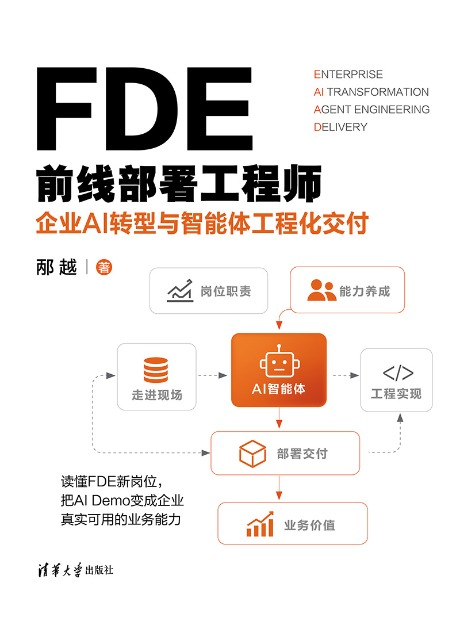

# Awesome-FDE

企业AI交付开放指南 · The Open Guide to Forward Deployed Engineering

> 从AI技术学习到企业价值交付。

[简体中文](README.md) · [English](README_EN.md)

[](https://github.com/fdeopen/awesome-fde)
[](https://github.com/fdeopen/awesome-fde/forks)
[](https://github.com/fdeopen/awesome-fde/graphs/contributors)
[](LICENSE)
[](https://github.com/fdeopen/awesome-fde/commits/main/)
[](CONTRIBUTING.md)

**Awesome-FDE 帮助 AI 实践者学习并交付企业 AI 项目：发现业务问题、构建可用系统、完成评测验收，再持续验证业务价值。**

本项目由 **FDE中国社区发起、FDEOpen 开源组织维护**，也是清华大学出版社《FDE前线部署工程师：企业AI转型与智能体工程化交付》的作者配套开源项目。这里统一提供学习路线、交付方法、工程练习、工作模板、案例索引与技术资源。

图书提供系统讲解，仓库提供持续更新的配套实践资料；**无需购书即可使用仓库中的原创开源内容**。主体资料以中文为主。

[开始学习](roadmap/README.md) · [推进项目](playbook/README.md) · [获取模板](toolkit/README.md) · [运行示例](#运行第一个示例) · [按章节学习](book/README.md)

<!-- book:start -->

## 图书与配套资料



### 《FDE前线部署工程师：企业AI转型与智能体工程化交付》

作者：邴越 · 清华大学出版社 · 2026-11-01 · ISBN 9787302729556

**正式出版，图书销量已突破2000册。**

系统学习FDE定位与能力、业务调研、场景与本体建模、PoC、知识工程、Agent工程化、生产治理及制造、电商与出海实践。

[图书详情](https://www.tup.tsinghua.edu.cn/booksCenter/book_11842501.html) · [正版购买：京东](https://item.jd.com/10239039021503.html) · [正版购买：天猫](https://detail.tmall.com/item.htm?id=1097057663551) · [开源配套资料](https://github.com/fdeopen/awesome-fde) · [完整目录](book/table-of-contents.md) · [加入社区](https://fdechina.ai/community/join) · [勘误反馈](book/errata.md)

出版信息核验：2026-11-19。

<!-- book:end -->

<a id="目录"></a>

## 导航

[什么是 FDE](#什么是-fde) · [从哪里开始](#从哪里开始) · [八大模块](#八大核心模块) · [学习路线](#学习路线怎么选) · [交付流程](#如何推进一个企业-ai-项目) · [运行示例](#运行第一个示例) · [公开案例](#公开案例) · [仓库结构](#仓库结构) · [社区生态](#社区生态) · [参与贡献](#参与贡献)

<a id="项目定位"></a>
<a id="fde-能力模型"></a>

## 什么是 FDE

**FDE（Forward Deployed Engineer，前线部署工程师）深入客户业务现场，将业务问题转化为可运行、可验收、可持续运营的系统，并对上线后的采用与业务结果负责。** 本仓库聚焦这一工作方式在企业 AI 项目中的实践。

FDE 的能力覆盖六个领域：**业务发现、软件与数据工程、AI 系统工程、客户共创、生产运营与治理、产品化与经营**。学习时用真实产物检验进展，例如业务基线、运行中的工作流、评测记录、运维手册和复用组件。各领域的能力证据与 L1–L5 责任范围见[能力模型](career/competency-model.md)。

<a id="适用人群"></a>

## 从哪里开始

按你现在要完成的任务选择入口，不必从头读完整个仓库。

| 你现在的需求 | 推荐入口 | 第一份产物 |
| --- | --- | --- |
| 了解 FDE，准备入行或转型 | [能力模型](career/competency-model.md) → [入门路线](roadmap/beginner.md) | 个人能力差距清单与一个练习目标 |
| 已有开发经验，想做 RAG / Agent 工程 | [工程进阶](roadmap/intermediate.md) → [离线练习](cookbook/examples/README.md) | 可复现的运行结果与失败样本 |
| 正在负责企业 AI 项目、产品或咨询交付 | [业务发现](playbook/business-discovery/README.md) → [机会卡](templates/discovery/opportunity-card.md) | 明确用户、问题、基线与成功条件的机会卡 |
| 需要项目文档与交付底稿 | [工具箱](toolkit/README.md) | 按当前阶段填写的一份模板 |
| 正在阅读配套图书 | [12 章学习导航](book/README.md) | 对应章节的练习与交付产物 |
| 调研行业场景、技术选型或创业方向 | [公开案例](cases/README.md) → [技术图谱](resources/frameworks.md) | 有来源与待验证假设的场景或选型清单 |

<a id="学习资源"></a>

## 八大核心模块

| 模块与入口 | 解决什么问题 | 当前可用内容 |
| --- | --- | --- |
| [FDE Book · 图书配套](book/README.md) | 读完一章后如何继续学习与练习？ | 12 章学习导航、正式目录、练习、勘误入口 |
| [FDE Roadmap · 学习路线](roadmap/README.md) | 从现有经验出发，下一步学什么？ | 3 条成长路线、能力模型与验收目标 |
| [FDE Playbook · 交付方法](playbook/README.md) | 项目每个阶段如何推进与交接？ | 12 阶段的目标、输入输出、方法与风险 |
| [FDE Toolkit · 交付工具箱](toolkit/README.md) | 需要记录哪些决策与交付证据？ | 30 项核心任务模板、检查单与 ROI 计算器 |
| [FDE Cookbook · 工程实践](cookbook/README.md) | 如何实现并验证一项工程能力？ | 10 份实践指南与 1 个可运行的离线练习 |
| [FDE Cases · 公开案例](cases/README.md) | 可以参考哪些业务场景与经验？ | 按行业精选的公开案例、阅读重点与交付拆解 |
| [FDE Projects · 实战项目](projects/README.md) | 如何组织一个完整应用项目？ | 10 项项目简报，分别标注可用组件与规划状态 |
| [FDE Resources · 技术资源](resources/README.md) | 学什么技术、查哪些官方资料？ | 大模型、Agent、RAG、AI Infra、评测等分类资源与框架图谱 |

**使用顺序可以是：Roadmap 定学习目标 → Playbook 定交付步骤 → Toolkit 留存证据 → Cookbook 验证技术。** Cases 和 Resources 用于查阅参考，Projects 用于选择实战方向，Book 提供按章节学习的入口。

<a id="学习与交付"></a>
<a id="四条学习路线"></a>

## 学习路线怎么选

按**当前能力与承担的责任**选择成长路线；每条路线都包含阶段任务、推荐资料与验收标准。

| 成长路线 | 适合谁 | 完成目标 |
| --- | --- | --- |
| [FDE 入门](roadmap/beginner.md) | AI 初学者、业务人员与转型学习者 | 一个范围明确的小应用、一份业务基线和一组评测样本 |
| [工程进阶](roadmap/intermediate.md) | 软件工程师、AI 工程师与架构师 | 具备权限控制、运行追踪、故障恢复与评测的 RAG / Agent 系统 |
| [企业交付专家](roadmap/advanced.md) | 资深 FDE、技术负责人、咨询顾问与企业 AI 负责人 | 覆盖业务验收、价值评估与资产沉淀的完整交付包 |

按**岗位方向**补充技术专题，可使用四条[分角色路线](learning-paths/README.md)：[AI 应用入门](learning-paths/ai-beginner.md)、[Agent 工程师](learning-paths/agent-engineer.md)、[企业 AI FDE](learning-paths/fde-engineer.md)、[AI Infra 与生产化](learning-paths/ai-infra-engineer.md)。两组路线分别回答“下一阶段要达到什么能力”和“当前岗位要重点练什么”，可搭配使用。

<a id="企业-ai-项目交付体系"></a>

## 如何推进一个企业 AI 项目

完整方法见 [12 阶段 Playbook](playbook/README.md)。下面将相邻阶段合并展示，方便理解从业务问题到持续运营的关系：


以“企业售后知识助手”为例，可以这样使用本仓库：

1. **定义问题**：用[业务访谈提纲](templates/discovery/interview-guide.md)了解一次真实处理流程，记录耗时、返工和人工判断环节。
2. **约定验证目标**：填写 [PoC 计划书](templates/poc/poc-charter.md)与[验收标准](toolkit/templates/poc-acceptance.md)，确定样本、质量门槛、成本和停止条件。
3. **构建并评测**：参考[权限感知 RAG](cookbook/rag/README.md)，用[评测报告](toolkit/templates/rag-evaluation.md)记录引用正确性、无证据弃答与越权访问结果。
4. **交付并复盘**：完成[上线检查](templates/acceptance/launch-gate.md)和[运维交接](toolkit/templates/handover.md)，按实际采用情况更新 [ROI 底稿](toolkit/templates/roi.md)。

[模拟服务台案例](cases/enterprise-services/synthetic-service-desk.md)展示完整的背景、方案、评测与价值分析，可与下面的离线练习配合使用。

## 运行第一个示例

先安装 Git 与 Python 3。在终端运行：

```bash
git clone https://github.com/fdeopen/awesome-fde.git
cd awesome-fde
python3 cookbook/examples/offline_delivery.py
```

已有本地仓库时，直接在仓库根目录运行最后一条命令。示例只使用 Python 标准库；克隆后运行无需联网、API 密钥或模型下载。

成功时输出 JSON，其中包含 `"passed": 7`。7 项断言覆盖检索与弃答、文档可见性、重复请求处理、越权拒绝和请求冲突。所有输入均为合成数据；这是验证工程控制的离线示例，不调用大模型，也不连接企业系统。运行细节与限制见[示例说明](cookbook/examples/README.md)。

下一步：修改一个样本并观察断言结果，将失败记录写入 [Bad Case 模板](toolkit/templates/bad-case.md)，再参考 [Cookbook](cookbook/README.md)扩展工程能力。业务价值估算可另用 [ROI 计算器](toolkit/calculators/README.md)。

<a id="案例与项目的收录范围"></a>
<a id="公开案例"></a>

<!-- public-cases:start -->

## 30 个公开案例

从公开资料中精选，覆盖 **7 个行业分类**。点击案例名称阅读来源文章；阅读重点由本项目整理。

[查看案例拆解](cases/selected.md) · [全部阅读资料](cases/catalog.md)

| 行业 | 公开案例 | 阅读重点 |
| --- | --- | --- |
| 制造业与汽车 | [Trinity Industries：铁路资产与维修账单审计](https://fdechina.ai/cases/insights/palantir-2026070807468) | 将维修规则、资产与账单关联到同一业务对象 |
| 制造业与汽车 | [Onshape + LLM：三轴云台 CAD 工作流](https://fdechina.ai/cases/insights/industry-2026070228195) | 让模型读取、修改并检查可版本化的 CAD 状态 |
| 制造业与汽车 | [悦点科技：本体驱动的设备运维](https://fdechina.ai/cases/insights/industry-2026011337810) | 统一设备、失效模式、工艺与运维动作的语义 |
| 制造业与汽车 | [汽车研发：合规导向的 CAD 数模校验](https://fdechina.ai/cases/insights/auto-compliant-model-design) | 把法规条款转成设计检查项与参数约束 |
| 电商与零售 | [高价率运营工作台：Skill 回归评测](https://fdechina.ai/cases/insights/ecom-ai-workbench) | 把运营 Skill 的质量变成可重复执行的评测 |
| 电商与零售 | [淘宝闪购：爆品团排序模型迭代](https://fdechina.ai/cases/insights/ecom-taobao-shangou-scaling) | 用统一模型主干与消融实验推进排序升级 |
| 电商与零售 | [得物：高可控客服 Agent](https://fdechina.ai/cases/insights/cs-2026071515026) | 分离流程控制、回复生成与质量评估 |
| 电商与零售 | [淘宝 GrowBrain：内容成长引擎](https://fdechina.ai/cases/insights/ecom-taobao-growbrain) | 用规划、执行与总结组织内容运营决策 |
| 电商与零售 | [淘宝企业购：面向 Skills 的客户系统对接](https://fdechina.ai/cases/insights/ecom-taobao-skills-rnd) | 将接口对接经验沉淀为版本化研发流程 |
| 电商与零售 | [森马：多模型与 MCP 统一接入](https://fdechina.ai/cases/insights/ecom-semir-ai-gateway) | 用 AI 网关管理鉴权、成本、回退与存量服务 |
| 电商与零售 | [Shopify：多 Agent 商品分类治理](https://fdechina.ai/cases/insights/ecom-shopify-ai-team) | 识别分类缺口、属性与商家标签的等价关系 |
| 电商与零售 | [RaceTrac：门店需求预测与运营调整](https://fdechina.ai/cases/insights/palantir-foundry-racetrac) | 结合天气、销售与门店模型调整人员和商品 |
| 电商与零售 | [1688：找挑一体的 AI 导购](https://fdechina.ai/cases/insights/ecom-1688-ai-native) | 把需求理解、商品检索与对比放进同一流程 |
| 电商与零售 | [淘工厂：电商内容 Agent 的演进](https://fdechina.ai/cases/insights/ecom-agent-content-scene) | 从批量生成延伸到内容诊断与投放反馈 |
| 电商与零售 | [淘宝：AI 试衣素材的商品系统集成](https://fdechina.ai/cases/insights/ecom-2024101825830) | 用离线任务、聚合写入与恢复机制承接生成结果 |
| 金融与保险 | [金智维：银行尽调报告的准确性治理](https://fdechina.ai/cases/insights/finance-bank-due-diligence) | 从业务人员与驳回记录中提炼隐性判断规则 |
| 金融与保险 | [中小银行：从 AI 助手到数据治理](https://fdechina.ai/cases/insights/finance-small-banks-experience) | 先验证小场景与员工采用，再扩大自动化范围 |
| 金融与保险 | [保险极客：团险理赔数字化](https://fdechina.ai/cases/insights/finance-insurance-claims) | 以理赔数据清洗与标签治理支撑全流程协同 |
| 金融与保险 | [广发金工：财报分析与报告生成 Skills](https://fdechina.ai/cases/insights/finance-gf-analysis-skills) | 确定性计算与有来源的文本归纳分工协作 |
| 金融与保险 | [Rogo：嵌入投行工作流的金融 Agent](https://fdechina.ai/cases/insights/finance-rogo-agent) | 将专业数据与引用接入 Excel、PowerPoint 工作流 |
| 金融与保险 | [邮储银行：智“会”锦囊运维问答](https://fdechina.ai/cases/insights/cs-2026011003571) | 把操作手册、问答对与未解决工单连成更新流程 |
| 金融与保险 | [山西证券：固收助理与合规知识问答](https://fdechina.ai/cases/insights/finance-shanzheng-practice) | 识别交易意图并保留人工处理与引用复核 |
| 医疗健康 | [Abridge：医疗对话转临床文档](https://fdechina.ai/cases/insights/health-abridge-documentation) | 把生成的文档摘要映射回对话证据 |
| 医疗健康 | [AiCure：临床试验中的用药行为记录](https://fdechina.ai/cases/insights/health-aicure-adherence) | 连接移动端视觉记录、患者报告与研究者工作台 |
| 医疗健康 | [Tempus AI：多模态医疗数据整理](https://fdechina.ai/cases/insights/health-tempus-data-engine) | 将病历、影像与基因报告转为可计算的数据 |
| 医疗健康 | [医疗器械客服：RAG Copilot 迁移排障](https://fdechina.ai/cases/insights/palantir-aip-rag-copilot) | 从检索片段过多的问题反查切分与索引设计 |
| 医疗健康 | [万木健康：基层医患服务工作流](https://fdechina.ai/cases/insights/wanmu-health-ai-practice) | 将专科知识、医生服务与区域化业务结合 |
| 物流与供应链 | [环世物流：AI 与低代码业务系统结合](https://fdechina.ai/cases/insights/huanshi-logistics-ai-cost) | 把询价等任务接入已有数字化业务流程 |
| 互联网与媒体 | [快手 KOncall：研发值班智能问答](https://fdechina.ai/cases/insights/cs-2026042937926) | 统一值班入口，并把问答、转人工与知识运营衔接 |
| 专业服务 | [标书编制：分步 Agent 与自动质检](https://fdechina.ai/cases/insights/de-2026072210756) | 先拆要求，再逐章生成、脚本检查与人工审核 |

<!-- public-cases:end -->

案例收录与更新方式见[维护说明](cases/curation.md)。实战项目的实现状态另见[项目目录](projects/project-catalog.md)。

<a id="本地研究报告"></a>
<a id="案例项目与历史资产"></a>

## 仓库结构

```text
awesome-fde/
├── book/             # 图书信息、正式目录与 12 章学习导航
├── roadmap/          # 按能力阶段组织的 3 条成长路线
├── playbook/         # 企业 AI 项目 12 阶段交付方法
├── toolkit/          # 核心任务模板、检查单、评测约定与计算器
├── cookbook/         # 工程实践指南与可运行的离线示例
├── cases/            # 公开案例精选、行业索引与交付拆解
├── projects/         # 实战项目简报与实现状态
├── resources/        # 技术图谱、框架、课程、论文与数据集
├── career/           # 六域能力模型与职业发展资料
├── learning-paths/   # 按岗位方向组织的 4 条学习路线
├── delivery/         # 原有 7 阶段交付指南
├── templates/        # 原有 13 份模板，部分由 Toolkit 引用
├── tools/            # 技术工具分类索引
├── reports/          # 两份 FDE 研究报告与摘要
├── community/        # 社区生态、贡献者与共创入口
├── assets/           # 图书封面与品牌资料
├── maintenance/      # 资产盘点、兼容性说明与核验记录
├── scripts/          # 索引生成与文档检查
└── .github/          # Issue / PR 模板与自动检查
```

原有资料继续保留原路径并由新模块引用。Toolkit 的 30 项核心任务模板中，5 项复用 `templates/`，25 项位于 `toolkit/templates/`；原模板库其余 8 项仍可使用。目录之间的关系见[兼容性说明](maintenance/migration.md)，研究背景见[报告索引](reports/README.md)。

<a id="fdechinaai"></a>

## 社区生态

<!-- ecosystem:start -->

| 入口 | 定位 |
| --- | --- |
| [FDEChina.ai](https://fdechina.ai/) | FDE中国社区与产业生态 |
| [FDEOpen.com](https://fdeopen.com/) | 企业AI产业媒体与开放技术生态 |
| [51FDE.net](https://51fde.net/) | FDE人才培养与职业成长 |
| [GitHub · FDEOpen](https://github.com/fdeopen) | 开源组织与共创项目 |

<!-- ecosystem:end -->

微信公众号：**FDE前线**。参阅[社区共创](community/README.md)、[活动](community/events.md)与[贡献者](community/contributors.md)。

<a id="收录标准"></a>
<a id="社区路线图"></a>

## 参与贡献

欢迎提交图书勘误、资料推荐、案例、项目、模板改进与工程实践记录。

1. 阅读[贡献指南](CONTRIBUTING.md)与[行为准则](CODE_OF_CONDUCT.md)，或从[首次贡献任务](community/good-first-issues.md)选择一个小改进。
2. 在 [Issue 表单](https://github.com/fdeopen/awesome-fde/issues/new/choose)中选择对应类型，说明问题、来源与预期改进；已有明确修改可直接提交 [Pull Request](https://github.com/fdeopen/awesome-fde/pulls)。
3. 为资源注明官方来源与核验时间，为案例说明授权和证据，为代码附运行条件、实测结果与维护责任。具体收录标准见[贡献指南](CONTRIBUTING.md)。

[Roadmap](ROADMAP.md) · [Changelog](CHANGELOG.md) · [升级报告](maintenance/upgrade-report.md)

<a id="免责声明与许可"></a>

## 许可与资料边界

原创文档与代码延续现有 [MIT 许可](LICENSE)。图书正文、封面、目录、第三方报告、文章、商标和外部项目保留各自权利与许可，见 [NOTICE](NOTICE)。仓库不公开图书全文；模拟数据明确标记；来源披露的效果不能视作另一项目的收益承诺。敏感问题按 [SECURITY](SECURITY.md) 私下反馈。
