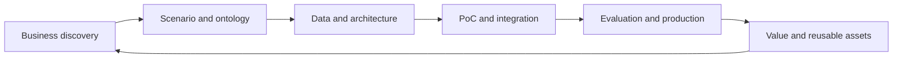

# Awesome-FDE

企业AI交付开放指南 · The Open Guide to Forward Deployed Engineering

> 从AI技术学习到企业价值交付。

[简体中文](README.md) · [English](README_EN.md)

Awesome-FDE 是由 FDE中国社区发起、FDEOpen 组织维护的企业AI交付开放知识项目，也是下方图书的作者配套开源项目。项目汇聚学习路线、行业案例、工程方法、Agent 与 RAG 实践、交付模板和开源资源，帮助实践者从技术学习走向企业价值交付。无需购书即可使用全部原创开源资料。

<!-- book:start -->

## 图书与配套资料

### 《FDE前线部署工程师：企业AI转型与智能体工程化交付》

作者：邴越 · 清华大学出版社 · 2026-11-01 · ISBN 9787302729556

**正式出版，图书销量已突破2000册（作者提供，未经独立审计）。**

系统学习FDE定位与能力、业务调研、场景与本体建模、PoC、知识工程、Agent工程化、生产治理及制造、电商与出海实践。

[图书详情](https://www.tup.tsinghua.edu.cn/booksCenter/book_11842501.html) · [正版购买：京东](https://item.jd.com/10239039021503.html) · [正版购买：天猫](https://detail.tmall.com/item.htm?id=1097057663551) · [开源配套资料](https://github.com/fdeopen/awesome-fde) · [完整目录](book/table-of-contents.md) · [加入社区](https://fdechina.ai/community/join) · [勘误反馈](book/errata.md)

出版信息核验：2026-11-19。

<!-- book:end -->

## 八大核心模块

| 模块 | 内容与入口 |
| --- | --- |
| FDE Book | [图书配套学习资料](book/README.md) |
| FDE Roadmap | [学习路线与能力模型](roadmap/README.md) |
| FDE Playbook | [企业AI交付方法论](playbook/README.md) |
| FDE Toolkit | [工程交付模板与工具](toolkit/README.md) |
| FDE Cookbook | [Agent、RAG、MCP工程实战](cookbook/README.md) |
| FDE Cases | [企业AI转型行业案例](cases/README.md) |
| FDE Projects | [开源实战项目](projects/README.md) |
| FDE Resources | [技术框架与精选资源](resources/README.md) |

快速跳转：[适用人群](#适用人群) · [学习与交付](#学习与交付) · [社区生态](#社区生态) · [参与贡献](#参与贡献) · [许可与资料边界](#许可与资料边界)

## 适用人群

AI工程师与Agent开发者、前线部署工程师、软件工程师与架构师、AI产品经理、企业数字化和AI转型负责人、咨询顾问、创业者，以及希望转型FDE的技术人员。

从这里建立能力计划，理解真实企业流程，掌握工程技术，复用交付方法，阅读行业案例，完成项目实战，并将可复用成果贡献给社区。

## 学习与交付

FDE深入业务现场，连接业务发现、软件与数据工程、AI系统、客户共创、生产治理和产品化经营，并对可验证的业务结果负责。详细定义与L1–L5责任阶梯见[能力模型](career/competency-model.md)。

| 路线 | 验收产物 |
| --- | --- |
| [FDE入门](roadmap/beginner.md) | 一个范围明确的小应用、一份业务基线和一组评测样本 |
| [工程进阶](roadmap/intermediate.md) | 具备权限、Trace、恢复与评测的RAG/Agent系统 |
| [企业交付专家](roadmap/advanced.md) | 覆盖验收、价值评估与资产沉淀的完整交付包 |

原有四条分角色路线继续保留在 [learning-paths](learning-paths/README.md)，六域能力与 L1–L5 模型继续维护在 [career](career/competency-model.md)。

沿 [12阶段 Playbook](playbook/README.md) 推进，用 [Toolkit](toolkit/README.md) 保存决策证据，再通过 [Cookbook](cookbook/README.md) 验证技术假设。先跑通离线练习，再接入企业系统。

## 案例、项目与历史资产

[案例索引](cases/catalog.md) 收录本地 FDE中国快照中的 119 篇案例与实践文章，属于阅读资料，不代表 119 个独立核验的企业交付项目。另有一个完整的[模拟教学案例](cases/enterprise-services/synthetic-service-desk.md)。此前提到的 200 份案例集合尚未定位；公开 fde-case-study 仓库核验时为空，缺失部分保留待补。

[10项项目目录](projects/project-catalog.md) 标明可复用组件与规划中的配套应用。两份报告、原有模板、交付方法和资源页保留原路径，详见[兼容性说明](maintenance/migration.md)与[报告索引](reports/README.md)。

## 社区生态

<!-- ecosystem:start -->

| 入口 | 定位 |
| --- | --- |
| [FDEChina.ai](https://fdechina.ai/) | FDE中国社区与产业生态 |
| [FDEOpen.com](https://fdeopen.com/) | 企业AI产业媒体与开放技术生态 |
| [51FDE.net](https://51fde.net/) | FDE人才培养与职业成长 |
| [GitHub · FDEOpen](https://github.com/fdeopen) | 开源组织与共创项目 |

<!-- ecosystem:end -->

微信公众号：**FDE前线**。参阅[社区共创](community/README.md)、[活动](community/events.md)与[贡献者](community/contributors.md)。

## 参与贡献

阅读[贡献指南](CONTRIBUTING.md)与[行为准则](CODE_OF_CONDUCT.md)，从[首次贡献任务](community/good-first-issues.md)入手，通过 [Issue](https://github.com/fdeopen/awesome-fde/issues/new/choose) 或 [Pull Request](https://github.com/fdeopen/awesome-fde/pulls) 提交改进。图书勘误、资源、案例、项目、模板、工程问题和社区建议均有专用表单。贡献需包含来源、核验时间、限制和维护责任。

[Roadmap](ROADMAP.md) · [Changelog](CHANGELOG.md) · [升级报告](maintenance/upgrade-report.md)

## 许可与资料边界

原创文档与代码延续现有 [MIT 许可](LICENSE)。图书正文、封面、目录、第三方报告、文章、商标和外部项目保留各自权利与许可，见 [NOTICE](NOTICE)。仓库不公开图书全文；模拟数据明确标记；来源披露的效果不能视作另一项目的收益承诺。敏感问题按 [SECURITY](SECURITY.md) 私下反馈。
