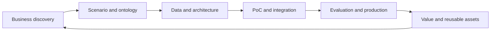

# Awesome-FDE

The Open Guide to Forward Deployed Engineering

> From AI Engineering to Enterprise Value

[简体中文](README.md) · [English](README_EN.md)

Initiated by the FDE China community and maintained within FDEOpen, Awesome-FDE connects learning, enterprise discovery, AI engineering and measurable business delivery. It is the author's open-source companion to the Chinese-language book introduced below. The guide is open to all practitioners; owning the book is not required.

<!-- book:start -->

## Book and companion materials

### 《FDE前线部署工程师：企业AI转型与智能体工程化交付》

Author: 邴越 · 清华大学出版社 · 2026-11-01 · ISBN 9787302729556

**Published; more than 2000 copies sold (author-reported, not independently audited).**

A Chinese-language guide to FDE roles, business discovery, ontology, PoC, knowledge engineering, Agents, production delivery and industry practice.

[Publisher details](https://www.tup.tsinghua.edu.cn/booksCenter/book_11842501.html) · [Buy: 京东](https://item.jd.com/10239039021503.html) · [Buy: 天猫](https://detail.tmall.com/item.htm?id=1097057663551) · [Open-source companion materials](https://github.com/fdeopen/awesome-fde) · [Full contents](book/table-of-contents.md) · [Join the community](https://fdechina.ai/community/join) · [Errata](book/errata.md)

Metadata checked: 2026-11-19。

<!-- book:end -->

## Navigate the guide

| Module | Start here |
| --- | --- |
| FDE Book | [Chapter companion and reading tasks](book/README.md) |
| FDE Roadmap | [Learning paths and competencies](roadmap/README.md) |
| FDE Playbook | [Enterprise delivery lifecycle](playbook/README.md) |
| FDE Toolkit | [Reusable templates and calculators](toolkit/README.md) |
| FDE Cookbook | [Engineering recipes and offline exercises](cookbook/README.md) |
| FDE Cases | [Industry case reading index](cases/README.md) |
| FDE Projects | [Project briefs and source repositories](projects/README.md) |
| FDE Resources | [Technology map and selected resources](resources/README.md) |

Quick links: [Learning paths](#learning-paths) · [Delivery workflow](#delivery-workflow) · [Community](#community) · [Contributing](#contributing) · [License](#license)

## Who this is for

AI engineers, Agent developers, FDEs, software engineers, architects, AI product managers, enterprise transformation leaders, consultants, founders and technical professionals moving into FDE roles.

Use the guide to build a competency plan, understand an operational workflow, choose engineering components, reuse delivery artifacts, study industry evidence and contribute reproducible project work.

## Learning paths

| Path | Outcome |
| --- | --- |
| [Beginner](roadmap/beginner.md) | A scoped application, a baseline and a small evaluation set |
| [Engineering](roadmap/intermediate.md) | An integrated RAG/Agent workflow with permissions, traces and recovery |
| [Delivery expert](roadmap/advanced.md) | A delivery package covering acceptance, value and reusable assets |

The four original role-based paths remain available in [learning-paths](learning-paths/README.md). Competency definitions remain in [career](career/competency-model.md).

## Delivery workflow

Follow the [12-stage Playbook](playbook/README.md), complete the [Toolkit](toolkit/README.md), and use the [Cookbook](cookbook/README.md) to test assumptions. Start with the offline exercise before connecting any enterprise systems.

## Evidence and project status

The [case index](cases/catalog.md) contains 119 article entries from an existing FDE China snapshot. These are reading references, not 119 independently audited deployments. A separate [synthetic case](cases/enterprise-services/synthetic-service-desk.md) illustrates the full delivery format. The requested 200-document collection has not been located. The public fde-case-study repository was empty when checked; no missing cases have been invented.

The [10-project catalog](projects/project-catalog.md) distinguishes available components from planned companion applications. Original reports, templates, delivery methods and resource pages remain at their existing paths; see the [migration note](maintenance/migration.md) and [research reports](reports/README.md).

## Community

<!-- ecosystem:start -->

| Entry | Role |
| --- | --- |
| [FDEChina.ai](https://fdechina.ai/) | FDE China community and industry ecosystem |
| [FDEOpen.com](https://fdeopen.com/) | Enterprise AI media and open technology ecosystem |
| [51FDE.net](https://51fde.net/) | FDE learning and career development |
| [GitHub · FDEOpen](https://github.com/fdeopen) | Open-source organization |

<!-- ecosystem:end -->

WeChat public account: **FDE前线**. See [community participation](community/README.md), [events](community/events.md) and [contributors](community/contributors.md).

## Contributing

Read the [contribution guide](CONTRIBUTING.md) and [code of conduct](CODE_OF_CONDUCT.md). Choose a [good first contribution](community/good-first-issues.md), submit an [Issue](https://github.com/fdeopen/awesome-fde/issues/new/choose), or open a [Pull Request](https://github.com/fdeopen/awesome-fde/pulls). Book errata, resources, cases, projects, templates, engineering questions and community ideas have dedicated forms. Include sources, evidence dates, limitations and maintenance ownership.

[Roadmap](ROADMAP.md) · [Changelog](CHANGELOG.md) · [Upgrade report](maintenance/upgrade-report.md)

## License

Original documentation and code use the existing [MIT license](LICENSE). The published book, its cover and table of contents, third-party reports, articles, trademarks and linked projects retain their own rights and licenses; see [NOTICE](NOTICE). This repository does not distribute the book's full text. Synthetic data is labeled as such. Source-reported results are not guarantees for another deployment. Report sensitive issues privately using [SECURITY](SECURITY.md).
