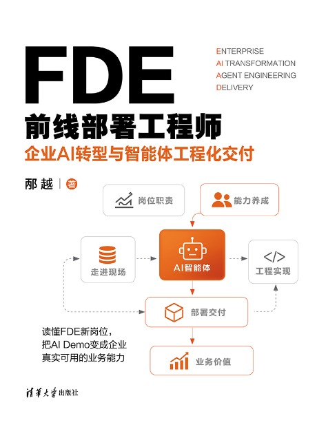
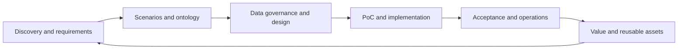

# Awesome-FDE

The Open Guide to Forward Deployed Engineering

> From AI Engineering to Enterprise Value

[简体中文](README.md) · [English](README_EN.md)

[](https://github.com/fdeopen/awesome-fde)
[](https://github.com/fdeopen/awesome-fde/forks)
[](https://github.com/fdeopen/awesome-fde/graphs/contributors)
[](LICENSE)
[](https://github.com/fdeopen/awesome-fde/commits/main/)
[](CONTRIBUTING.md)

**Awesome-FDE helps AI practitioners learn to deliver enterprise AI projects: understand a business problem, build a working system, evaluate it, and measure its value in use.**

Initiated by the **FDE China community and maintained by FDEOpen**, it is also the author's open-source companion to *FDE前线部署工程师：企业AI转型与智能体工程化交付*, published by Tsinghua University Press. The repository brings together learning paths, delivery methods, engineering exercises, templates, case references and technical resources.

The book provides a structured explanation; this repository provides evolving practice materials. **You can use the original open-source materials without buying the book.** Most linked documents are in Chinese.

[Start learning](roadmap/README.md) · [Deliver a project](playbook/README.md) · [Find a template](toolkit/README.md) · [Run an example](#run-your-first-example) · [Study by chapter](book/README.md)

<!-- book:start -->

## Book and companion materials



### 《FDE前线部署工程师：企业AI转型与智能体工程化交付》

Author: 邴越 · 清华大学出版社 · 2026-11-01 · ISBN 9787302729556

**Published; more than 2000 copies sold.**

A Chinese-language guide to FDE roles, business discovery, ontology, PoC, knowledge engineering, Agents, production delivery and industry practice.

[Publisher details](https://www.tup.tsinghua.edu.cn/booksCenter/book_11842501.html) · [Buy: 京东](https://item.jd.com/10239039021503.html) · [Buy: 天猫](https://detail.tmall.com/item.htm?id=1097057663551) · [Open-source companion materials](https://github.com/fdeopen/awesome-fde) · [Full contents](book/table-of-contents.md) · [Join the community](https://fdechina.ai/community/join) · [Errata](book/errata.md)

Metadata checked: 2026-11-19。

<!-- book:end -->

## Navigate the guide

[What is an FDE?](#what-is-an-fde) · [Where to start](#where-to-start) · [Eight modules](#eight-core-modules) · [Learning paths](#learning-paths) · [Delivery workflow](#delivery-workflow) · [Run an example](#run-your-first-example) · [Public cases](#public-cases) · [Repository layout](#repository-layout) · [Community](#community) · [Contributing](#contributing)

## What is an FDE?

**A Forward Deployed Engineer works closely with customers to turn operational problems into systems that can be run, evaluated and maintained, with responsibility for adoption and business outcomes after launch.** This repository focuses on that approach to enterprise AI delivery.

The competency model covers six areas: **business discovery, software and data engineering, AI systems engineering, customer collaboration, production operations and governance, and productization and business management**. Assess progress through artifacts such as a business baseline, a working workflow, evaluation results, an operations manual and a reused component. See the [competency model](career/competency-model.md) for evidence requirements and L1–L5 responsibilities.

<a id="who-this-is-for"></a>

## Where to start

Choose the task you need to complete. You do not need to read the repository in order.

| Your goal | Recommended entry | First artifact |
| --- | --- | --- |
| Understand FDE roles or plan a career transition | [Competency model](career/competency-model.md) → [Beginner path](roadmap/beginner.md) | A skills gap list and one practice goal |
| Build RAG / Agent systems with existing development experience | [Engineering path](roadmap/intermediate.md) → [Offline exercise](cookbook/examples/README.md) | Reproducible results and failure cases |
| Lead an enterprise AI project, product or consulting engagement | [Business discovery](playbook/business-discovery/README.md) → [Opportunity card](templates/discovery/opportunity-card.md) | Defined users, problem, baseline and success criteria |
| Prepare project documentation | [Toolkit](toolkit/README.md) | A completed template for the current stage |
| Follow the companion book | [12-chapter study guide](book/README.md) | A chapter exercise and its deliverable |
| Research industry use cases, technology choices or startup opportunities | [Public cases](cases/README.md) → [Technology map](resources/frameworks.md) | Sourced options and hypotheses to validate |

## Eight core modules

| Module | Question it answers | Available material |
| --- | --- | --- |
| [FDE Book](book/README.md) | What should I study and practice after each chapter? | Guides for 12 chapters, official contents, exercises and errata |
| [FDE Roadmap](roadmap/README.md) | What should I learn next? | 3 progression paths, competencies and acceptance goals |
| [FDE Playbook](playbook/README.md) | How do I move a project through each stage? | Goals, inputs, outputs, methods and risks across 12 stages |
| [FDE Toolkit](toolkit/README.md) | Which decisions and evidence should I document? | 30 core task templates, checklists and an ROI calculator |
| [FDE Cookbook](cookbook/README.md) | How do I implement and validate an engineering capability? | 10 practice guides and 1 runnable offline exercise |
| [FDE Cases](cases/README.md) | Which business scenarios and experiences can I study? | Public cases selected by industry, with reading notes and delivery lessons |
| [FDE Projects](projects/README.md) | How do I scope a complete application? | 10 project briefs with component availability and planning status |
| [FDE Resources](resources/README.md) | Which technologies and official references should I study? | Resources for LLMs, Agents, RAG, AI infrastructure, evaluation and related topics |

**Use Roadmap to set a learning goal, Playbook to plan delivery, Toolkit to document evidence, and Cookbook to validate the engineering.** Consult Cases and Resources for references, Projects for application briefs, and Book for chapter-based study.

## Learning paths

Choose a progression path by **current capability and responsibility**. Each includes staged tasks, references and acceptance criteria.

| Path | Starting point | Outcome |
| --- | --- | --- |
| [Beginner](roadmap/beginner.md) | AI newcomers, business practitioners and career changers | A scoped application, a business baseline and a small evaluation set |
| [Engineering](roadmap/intermediate.md) | Software engineers, AI engineers and architects | A RAG / Agent system with access controls, traces, recovery and evaluation |
| [Delivery expert](roadmap/advanced.md) | Experienced FDEs, technical leads, consultants and enterprise AI leaders | A delivery package covering business acceptance, value and reusable assets |

For **role-specific topics**, use the four [role paths](learning-paths/README.md): [AI application beginner](learning-paths/ai-beginner.md), [Agent engineer](learning-paths/agent-engineer.md), [Enterprise AI FDE](learning-paths/fde-engineer.md), and [AI infrastructure and production](learning-paths/ai-infra-engineer.md). The progression paths define your next capability level; the role paths help select topics for your work. They can be used together.

## Delivery workflow

The [12-stage Playbook](playbook/README.md) covers the full lifecycle. This diagram groups adjacent stages to show how business discovery connects to delivery and continuing operations:



For an enterprise support knowledge assistant, use the materials as follows:

1. **Define the problem:** use the [interview guide](templates/discovery/interview-guide.md) to examine a real support workflow, including time spent, rework and human decisions.
2. **Agree on validation:** complete the [PoC charter](templates/poc/poc-charter.md) and [acceptance criteria](toolkit/templates/poc-acceptance.md), defining samples, quality thresholds, costs and stopping conditions.
3. **Build and evaluate:** follow the [permission-aware RAG guide](cookbook/rag/README.md) and record citation accuracy, abstention and access-control results in an [evaluation report](toolkit/templates/rag-evaluation.md).
4. **Deliver and review:** complete the [launch checklist](templates/acceptance/launch-gate.md) and [operations handover](toolkit/templates/handover.md), then update the [ROI worksheet](toolkit/templates/roi.md) using observed adoption.

The [synthetic service-desk case](cases/enterprise-services/synthetic-service-desk.md) illustrates the business context, design, evaluation and value analysis. Use it alongside the offline exercise below.

## Run your first example

With Git and Python 3 installed, run:

```bash
git clone https://github.com/fdeopen/awesome-fde.git
cd awesome-fde
python3 cookbook/examples/offline_delivery.py
```

If you already have a local checkout, run the last command from its root. The example uses only the Python standard library. After cloning, execution needs no network connection, API keys or model downloads.

Successful execution prints JSON containing `"passed": 7`. The assertions cover retrieval and abstention, document visibility, repeated requests, unauthorized access and conflicting requests. All inputs are synthetic. The exercise demonstrates engineering controls without calling an LLM or connecting to enterprise systems; see the [example guide](cookbook/examples/README.md) for details and limitations.

Next, change a sample, inspect the assertion result and record failures in the [Bad Case template](toolkit/templates/bad-case.md). Continue with the [Cookbook](cookbook/README.md) to develop engineering capabilities. A separate [ROI calculator](toolkit/calculators/README.md) supports business value estimates.

<a id="evidence-and-project-status"></a>
<a id="public-cases"></a>

<!-- public-cases:start -->

## 30 public cases

Selected from public articles across **7 industry categories**. Case titles link to the source articles; summaries are curated for this guide.

[Case notes](cases/selected.md) · [Full reading index](cases/catalog.md)

| Industry | Public case | What to study |
| --- | --- | --- |
| Manufacturing and automotive | [Trinity Industries: rail asset and invoice review](https://fdechina.ai/cases/insights/palantir-2026070807468) | Connect maintenance rules, assets and invoices |
| Manufacturing and automotive | [Onshape and LLMs: a gimbal CAD workflow](https://fdechina.ai/cases/insights/industry-2026070228195) | Read, edit and inspect versioned CAD state |
| Manufacturing and automotive | [Yuedian: ontology-driven equipment maintenance](https://fdechina.ai/cases/insights/industry-2026011337810) | Align equipment, failure modes and maintenance actions |
| Manufacturing and automotive | [Automotive engineering: compliance-aware CAD checks](https://fdechina.ai/cases/insights/auto-compliant-model-design) | Map requirements to CAD checks and parameters |
| E-commerce and retail | [Pricing operations: regression evaluation for Skills](https://fdechina.ai/cases/insights/ecom-ai-workbench) | Make operational Skill quality repeatably testable |
| E-commerce and retail | [Taobao Instant Commerce: ranking model iteration](https://fdechina.ai/cases/insights/ecom-taobao-shangou-scaling) | Use a unified backbone and ablation studies |
| E-commerce and retail | [Dewu: controlled customer-service Agents](https://fdechina.ai/cases/insights/cs-2026071515026) | Separate orchestration, replies and evaluation |
| E-commerce and retail | [Taobao GrowBrain: content growth orchestration](https://fdechina.ai/cases/insights/ecom-taobao-growbrain) | Organize content decisions through plan, execute and summarize |
| E-commerce and retail | [Taobao Enterprise: Skills for customer integrations](https://fdechina.ai/cases/insights/ecom-taobao-skills-rnd) | Turn integration expertise into versioned workflows |
| E-commerce and retail | [Semir: unified model and MCP access](https://fdechina.ai/cases/insights/ecom-semir-ai-gateway) | Manage access, cost, fallback and existing services |
| E-commerce and retail | [Shopify: multi-Agent product taxonomy governance](https://fdechina.ai/cases/insights/ecom-shopify-ai-team) | Identify taxonomy gaps and equivalent merchant labels |
| E-commerce and retail | [RaceTrac: store demand and operational planning](https://fdechina.ai/cases/insights/palantir-foundry-racetrac) | Connect weather, sales and store-level models |
| E-commerce and retail | [1688: integrated product search and selection](https://fdechina.ai/cases/insights/ecom-1688-ai-native) | Unify intent, product retrieval and comparison |
| E-commerce and retail | [Taofactory: evolving content Agents](https://fdechina.ai/cases/insights/ecom-agent-content-scene) | Extend generation into content diagnosis and feedback |
| E-commerce and retail | [Taobao: integrating AI try-on assets](https://fdechina.ai/cases/insights/ecom-2024101825830) | Deliver generated assets through resilient batch jobs |
| Finance and insurance | [Kingsware: accuracy in bank due-diligence reports](https://fdechina.ai/cases/insights/finance-bank-due-diligence) | Capture implicit rules from reviewers and revisions |
| Finance and insurance | [Community banks: assistants, adoption and data quality](https://fdechina.ai/cases/insights/finance-small-banks-experience) | Validate narrow use cases and staff adoption first |
| Finance and insurance | [Insurance Geek: digital group-insurance claims](https://fdechina.ai/cases/insights/finance-insurance-claims) | Build claims workflows on normalized data and labels |
| Finance and insurance | [GF research: financial analysis and reporting Skills](https://fdechina.ai/cases/insights/finance-gf-analysis-skills) | Separate deterministic calculations from sourced summaries |
| Finance and insurance | [Rogo: financial Agents inside analyst workflows](https://fdechina.ai/cases/insights/finance-rogo-agent) | Bring licensed data and citations into analyst tools |
| Finance and insurance | [Postal Savings Bank: operational support Q&A](https://fdechina.ai/cases/insights/cs-2026011003571) | Connect manuals, Q&A pairs and unresolved tickets |
| Finance and insurance | [Shanxi Securities: bond assistance and compliance Q&A](https://fdechina.ai/cases/insights/finance-shanzheng-practice) | Recognize intent while retaining human review and citations |
| Healthcare | [Abridge: clinical documentation from conversations](https://fdechina.ai/cases/insights/health-abridge-documentation) | Link generated clinical notes back to conversation evidence |
| Healthcare | [AiCure: medication adherence records in clinical trials](https://fdechina.ai/cases/insights/health-aicure-adherence) | Connect visual records, patient reports and research workflows |
| Healthcare | [Tempus AI: structuring multimodal medical data](https://fdechina.ai/cases/insights/health-tempus-data-engine) | Structure records, images and genomic reports |
| Healthcare | [Medical-device support: troubleshooting a RAG migration](https://fdechina.ai/cases/insights/palantir-aip-rag-copilot) | Trace excessive retrieval back to chunking and indexing |
| Healthcare | [Wanmu Health: workflows for community healthcare services](https://fdechina.ai/cases/insights/wanmu-health-ai-practice) | Connect specialist knowledge with local service workflows |
| Logistics and supply chains | [Huanshi Logistics: AI in low-code business workflows](https://fdechina.ai/cases/insights/huanshi-logistics-ai-cost) | Integrate quotation tasks into existing business workflows |
| Internet and media | [Kuaishou KOncall: intelligent engineering support](https://fdechina.ai/cases/insights/cs-2026042937926) | Unify support entry, RAG, handoff and knowledge operations |
| Professional services | [Bid preparation: staged Agents and automated checks](https://fdechina.ai/cases/insights/de-2026072210756) | Extract requirements, draft by chapter and review |

<!-- public-cases:end -->

See the [curation guide](cases/curation.md) for inclusion and maintenance. Application implementation status is tracked separately in the [project catalog](projects/project-catalog.md).

## Repository layout

```text
awesome-fde/
├── book/             # Book metadata, official contents and 12 chapter guides
├── roadmap/          # 3 paths organized by capability and responsibility
├── playbook/         # 12-stage enterprise AI delivery lifecycle
├── toolkit/          # Core task templates, checklists and calculators
├── cookbook/         # Engineering guides and the runnable offline exercise
├── cases/            # Selected public cases, industry index and delivery notes
├── projects/         # Project briefs and implementation status
├── resources/        # Frameworks, courses, papers, datasets and technology map
├── career/           # Six-domain competency model and career materials
├── learning-paths/   # 4 paths organized by role
├── delivery/         # Original 7-stage delivery guides
├── templates/        # Original 13 templates, some referenced by Toolkit
├── tools/            # Categorized technology tools
├── reports/          # Two FDE research reports and summaries
├── community/        # Ecosystem, contributors and participation
├── assets/           # Book cover and brand materials
├── maintenance/      # Inventory, compatibility notes and verification records
├── scripts/          # Index generation and documentation checks
└── .github/          # Issue / PR templates and automated checks
```

Existing materials retain their paths and are referenced by the new modules. Of Toolkit's 30 core task templates, 5 reuse `templates/` and 25 live in `toolkit/templates/`; the other 8 original templates remain available. See the [compatibility note](maintenance/migration.md) for directory relationships and the [research reports](reports/README.md) for background.

## Community

<!-- ecosystem:start -->

| Entry | Role |
| --- | --- |
| [FDEChina.ai](https://fdechina.ai/) | FDE China community and industry ecosystem |
| [FDEOpen.com](https://fdeopen.com/) | Enterprise AI media and open technology ecosystem |
| [51FDE.net](https://51fde.net/) | FDE learning and career development |
| [GitHub · FDEOpen](https://github.com/fdeopen) | Open-source organization |

<!-- ecosystem:end -->

WeChat public account: **FDE前线**. See [community participation](community/README.md), [events](community/events.md) and [contributors](community/contributors.md).

## Contributing

Contributions can include book corrections, resources, cases, projects, template improvements and engineering experience.

1. Read the [contribution guide](CONTRIBUTING.md) and [code of conduct](CODE_OF_CONDUCT.md), or choose a [good first contribution](community/good-first-issues.md).
2. Select an [Issue form](https://github.com/fdeopen/awesome-fde/issues/new/choose) and describe the problem, source and proposed improvement. If the change is clear, submit a [Pull Request](https://github.com/fdeopen/awesome-fde/pulls) directly.
3. Include official sources and verification dates for resources, permission and evidence for cases, and runtime requirements, test results and maintenance ownership for code. Detailed inclusion criteria are in the [contribution guide](CONTRIBUTING.md).

[Roadmap](ROADMAP.md) · [Changelog](CHANGELOG.md) · [Upgrade report](maintenance/upgrade-report.md)

## License

Original documentation and code use the existing [MIT license](LICENSE). The published book, its cover and table of contents, third-party reports, articles, trademarks and linked projects retain their own rights and licenses; see [NOTICE](NOTICE). This repository does not distribute the book's full text. Synthetic data is labeled as such. Source-reported results are not guarantees for another deployment. Report sensitive issues privately using [SECURITY](SECURITY.md).
