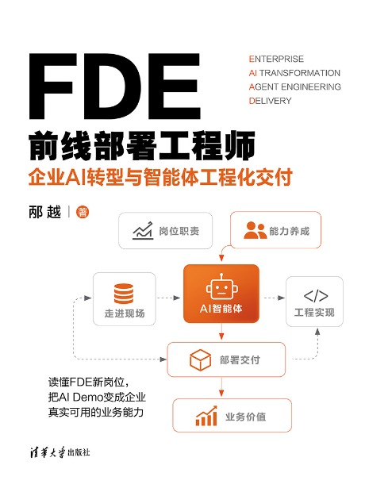

# FDE Book · 图书配套学习中心

<!-- book:start -->

## 图书与配套资料

### 《FDE前线部署工程师：企业AI转型与智能体工程化交付》

作者：邴越 · 清华大学出版社 · 2026-11-01 · ISBN 9787302729556

**正式出版，图书销量已突破2000册。**

系统学习FDE定位与能力、业务调研、场景与本体建模、PoC、知识工程、Agent工程化、生产治理及制造、电商与出海实践。

[图书详情](https://www.tup.tsinghua.edu.cn/booksCenter/book_11842501.html) · [正版购买：京东](https://item.jd.com/10239039021503.html) · [正版购买：天猫](https://detail.tmall.com/item.htm?id=1097057663551) · [开源配套资料](https://github.com/fdeopen/awesome-fde) · [完整目录](table-of-contents.md) · [加入社区](https://fdechina.ai/community/join) · [勘误反馈](errata.md)

出版信息核验：2026-11-19。

<!-- book:end -->

## 从哪里开始

[图书介绍](introduction.md) · [作者](author.md) · [完整目录](table-of-contents.md) · [常见问题](faq.md) · [勘误](errata.md)

<!-- chapters:start -->

| 章 | 正式章名 | 起始页 | 配套学习 |
| --- | --- | ---: | --- |
| 1 | 企业AI为何难以跨越试点：FDE的兴起与价值 | 1 | [进入](chapters/01.md) |
| 2 | 站在业务与技术之间：FDE的职责、能力、授权与协作 | 23 | [进入](chapters/02.md) |
| 3 | 从个人FDE到组织能力：成长路径、团队机制与资产沉淀 | 48 | [进入](chapters/03.md) |
| 4 | 走进现场：从第一次会谈到业务真相 | 84 | [进入](chapters/04.md) |
| 5 | 抽象问题：从业务流程到AI场景与企业本体 | 113 | [进入](chapters/05.md) |
| 6 | 推动落地：从PoC到生产、验收与组织采用 | 147 | [进入](chapters/06.md) |
| 7 | 快速验证：模型调用、低代码平台与原型工程 | 179 | [进入](chapters/07.md) |
| 8 | 企业知识工程：提示词、上下文、RAG与企业本体 | 207 | [进入](chapters/08.md) |
| 9 | 从工作流到智能体：工具调用、Skill、MCP与运行时 | 238 | [进入](chapters/09.md) |
| 10 | 从能跑到可交付：评测、可观测性、部署、安全与治理 | 260 | [进入](chapters/10.md) |
| 11 | 制造业：从知识助手到受控设备智能体 | 290 | [进入](chapters/11.md) |
| 12 | 电商、营销与出海：从内容生产到搜索、订单与利润闭环 | 314 | [进入](chapters/12.md) |

<!-- chapters:end -->

每章提供目标、知识地图、已有资源、工程模板、练习、常见问题与更新记录。这些是原创配套学习资料，不是图书正文摘录。

按成长阶段学习可转入[Roadmap](../roadmap/README.md)，项目交付可转入[Playbook](../playbook/README.md)，生态入口见[社区](../community/README.md)。
